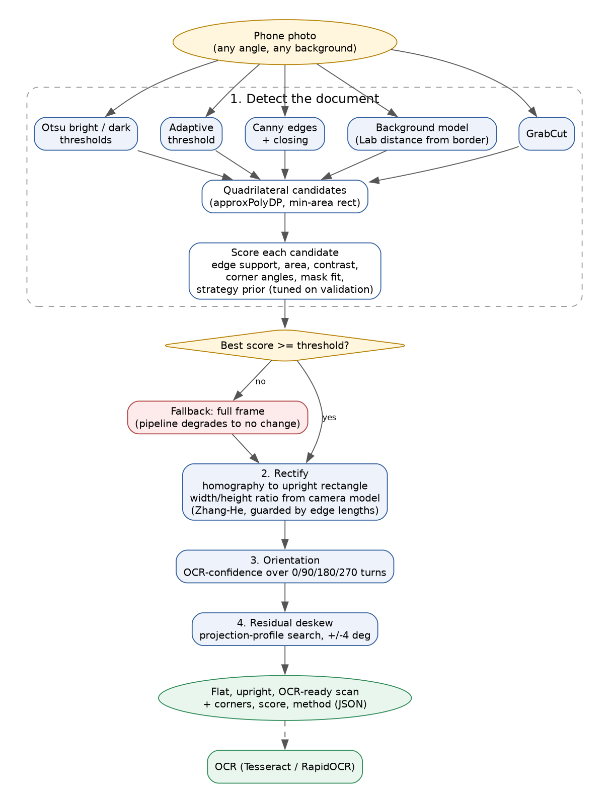
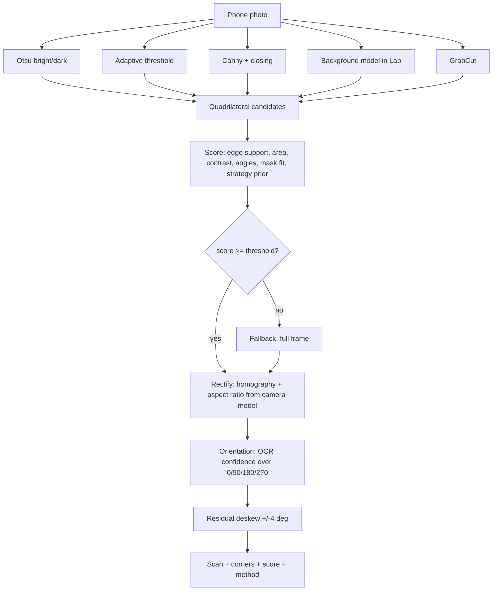
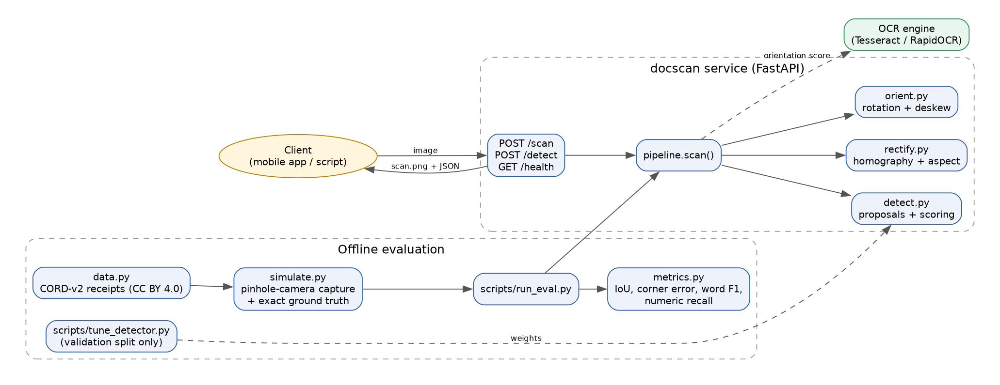
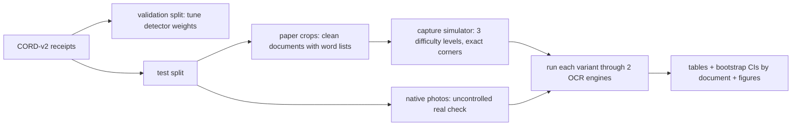

# Architecture

## Goal
Turn a phone photo of a receipt or document into a flat, upright scan that OCR reads accurately, and *measure* how much that helps.

## Pipeline flow

## System view

## Components
| Module | Responsibility | Notes |
|---|---|---|
| `docscan/detect.py` | Propose and rank document quadrilaterals | Five proposal strategies. Scoring weights tuned on the validation split only (`scripts/tune_detector.py`, stored in `tuned_weights.json`). Returns the full ranked candidate list for debugging. |
| `docscan/rectify.py` | Homography to an upright rectangle | Output aspect ratio recovered with Zhang and He (2007), guarded: if it disagrees with the edge-length ratio by more than 25% the edge-length estimate is used. |
| `docscan/orient.py` | Page orientation and residual skew | Orientation picks the quarter-turn whose Tesseract pass has the most confident words. Skew uses a projection-profile search and only acts on a clear gain. |
| `docscan/pipeline.py` | `scan()` entry point | Detect, rectify, orient, deskew. Each stage can be switched off for ablations. |
| `docscan/api.py` | FastAPI service | `POST /scan`, `POST /detect`, `GET /health`. Input validation returns 400 on undecodable images. |
| `docscan/simulate.py` | Capture simulator | Pinhole camera (yaw, pitch, roll, distance, focal length), random background, lighting gradient, shadow band, blur, noise, JPEG. Gives exact ground-truth corners. |
| `docscan/data.py` | CORD-v2 loader | Flattens the annotated paper region into a clean source document with its word list. |
| `docscan/metrics.py` | Scoring | Corner error, IoU, word precision/recall/F1 (reading-order free), numeric-token recall. |
| `scripts/run_eval.py` | Evaluation harness | Test split only. Runs every variant through two OCR engines in parallel. |
| `scripts/make_report.py` | Tables, figures, bootstrap intervals | Resamples documents, not captures. |

## Failure handling
- No acceptable quadrilateral: the full frame is used, so the pipeline degrades to "no change".
- Zhang-He degenerate or implausible: edge-length sizing.
- Orientation scores all close: keep the current orientation (a quarter-turn must beat it by more than 15%).
- Skew gain under 5%: no rotation.
- Undecodable upload: HTTP 400.

## Evaluation design

